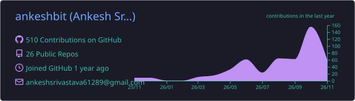
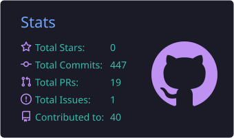
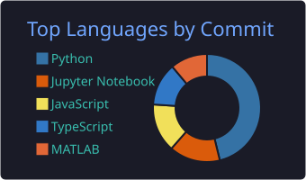
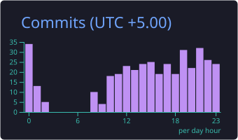

---

### 👋 About Me

I'm a **MERN Full-Stack Developer** based in Gorakhpur, India, passionate about building scalable web applications and intelligent ML systems. I love taking products from raw idea to production — clean architecture, clear code, and real-world impact.

- 🔭 Currently **exploring projects and open to opportunities**
- 🌱 Deepening skills in **LLMs, RAG pipelines, and distributed systems**
- 💬 Ask me about **React, Node.js, FastAPI, or anything ML**
- 📬 Open to **full-time roles, freelance work, and collaborations**
- ⚡ Fun fact: I debug faster with coffee ☕

---

### 🚀 What I Do

- 🧩 Design and build **scalable full-stack web applications**
- 🤖 Develop **end-to-end ML workflows** (data → model → deployment → insights)
- ⚙️ Engineer systems with a focus on **performance, clarity, and longevity**
- 🚢 Take products from **idea to deployment**
- 🛠️ Contribute to **open-source** projects and communities

---

### 🧠 Tech Stack

**Frontend**

**Backend & APIs**

**AI / ML**

**Databases & DevOps**

---

### 📊 GitHub Stats

---

### 🏆 GitHub Profile Summary

---

### 📈 Contribution Graph

---

*Backend-first. Data-aware. Built to scale.*

